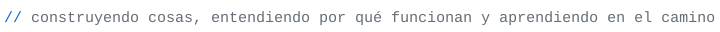
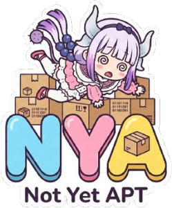
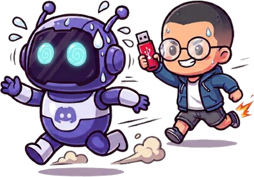

<picture>
  <source media="(prefers-color-scheme: dark)" srcset="assets/wordmark-dark.svg">
  <source media="(prefers-color-scheme: light)" srcset="assets/wordmark-light.svg">
  
</picture>

<picture>
  <source media="(prefers-color-scheme: dark)" srcset="assets/tagline-dark.svg">
  <source media="(prefers-color-scheme: light)" srcset="assets/tagline-light.svg">
  
</picture>

<picture>
  <source media="(prefers-color-scheme: dark)" srcset="assets/sec-whoami-dark.svg">
  <source media="(prefers-color-scheme: light)" srcset="assets/sec-whoami-light.svg">
  
</picture>

```text
rol      estudiante de ingeniería de software · Universidad de Guayaquil, Ecuador
foco     backend · arquitectura de software · sistemas · redes
```

Soy Julián Garzón, estudiante de Ingeniería de Software y alguien que disfruta comprender cómo funcionan las cosas. Una de las actividades que más disfruto es redescubrir conceptos, mecanismos e ideas que otros ya han explorado, reconstruyendo por mi cuenta el razonamiento que hay detrás de ellos.

Esta curiosidad me ha llevado a interesarme especialmente por los fundamentos de la computación y las tecnologías de bajo nivel. Disfruto trabajar con lenguajes como C y Rust, explorar cómo funcionan los sistemas y entender qué sucede detrás de las abstracciones que utilizamos a diario.

Más allá de las tecnologías o etiquetas profesionales con las que pueda identificarme, me interesa abordar problemas, comprender sus particularidades y diseñar soluciones. Esto me lleva a explorar áreas como el desarrollo backend, los sistemas distribuidos y la automatización, incluyendo soluciones impulsadas por inteligencia artificial.

Me gusta construir cosas, experimentar, cuestionar cómo funcionan y, sobre todo, entender por qué funcionan.

<picture> <source media="(prefers-color-scheme: dark)" srcset="assets/sec-proyectos-dark.svg"> <source media="(prefers-color-scheme: light)" srcset="assets/sec-proyectos-light.svg">  </picture> <table> <tr> <td width="50%" align="center" valign="top"> <a href="https://github.com/wblade-jg/nya"></a> <br><br> <a href="https://github.com/wblade-jg/nya"><b>nya</b></a> <br> Gestor de paquetes en Rust, diseñado a partir de los fundamentos de APT.<br> Implementación del índice de paquetes y actualización de repositorios. <code>install</code> en desarrollo. <br><br> <sub>Rust</sub> </td> <td width="50%" align="center" valign="top"> <a href="https://github.com/wblade-jg/discord-mcp"></a> <br><br> <a href="https://github.com/wblade-jg/discord-mcp"><b>discord-mcp</b></a> <br> Servidor MCP para Discord, implementado desde el protocolo sobre stdio y JSON-RPC 2.0, sin SDK. <br><br> <sub>Python</sub> </td> </tr> </table> <p align="center">Más en <a href="https://github.com/wblade-jg?tab=repositories">mis repositorios</a>.</p> <picture> <source media="(prefers-color-scheme: dark)" srcset="assets/sec-stack-dark.svg"> <source media="(prefers-color-scheme: light)" srcset="assets/sec-stack-light.svg">  </picture> 

<div align="center">

**Languages**

<picture>
  <source media="(prefers-color-scheme: dark)" srcset="https://skillicons.dev/icons?i=rust%2Cc%2Cpy%2Ccs%2Cts&theme=dark">
  <source media="(prefers-color-scheme: light)" srcset="https://skillicons.dev/icons?i=rust%2Cc%2Cpy%2Ccs%2Cts&theme=light">
  
</picture>

**Backend & AI**

<picture>
  <source media="(prefers-color-scheme: dark)" srcset="https://skillicons.dev/icons?i=fastapi%2Cdotnet%2Cnodejs%2Cpytorch&theme=dark">
  <source media="(prefers-color-scheme: light)" srcset="https://skillicons.dev/icons?i=fastapi%2Cdotnet%2Cnodejs%2Cpytorch&theme=light">
  
</picture>

**Infrastructure & Tools**
<picture>
  <source media="(prefers-color-scheme: dark)" srcset="https://skillicons.dev/icons?i=aws%2Cdocker%2Clinux%2Cgit%2Cgithubactions&theme=dark">
  <source media="(prefers-color-scheme: light)" srcset="https://skillicons.dev/icons?i=aws%2Cdocker%2Clinux%2Cgit%2Cgithubactions&theme=light">
  
</picture>

**Databases**

<picture>
  <source media="(prefers-color-scheme: dark)" srcset="https://skillicons.dev/icons?i=postgres%2Credis&theme=dark">
  <source media="(prefers-color-scheme: light)" srcset="https://skillicons.dev/icons?i=postgres%2Credis&theme=light">
  
</picture>

</div>
